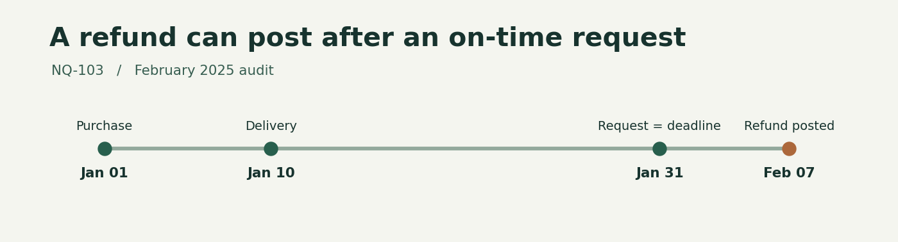
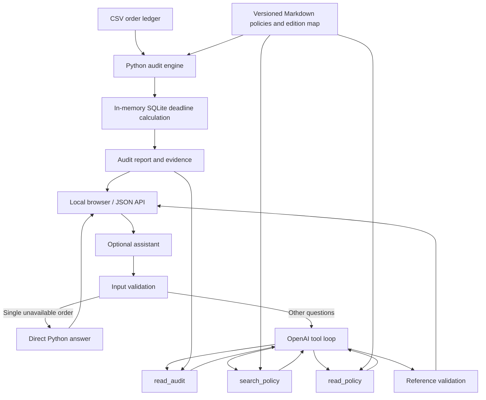

# ReturnLedger

A refund was posted on February 7, but the customer requested the return on January 31, the last eligible day. Should the order be flagged as late? No: the request date determines timeliness, while the refund date determines the reporting month.

ReturnLedger is a Python and SQLite portfolio project that audits refund timelines for a fictional shop, North Quay Supply. It combines reproducible business rules with an optional AI assistant that explains findings using read-only tools and policy citations. The audit runs independently of the model.



## Features

- CSV ingestion, calendar-date validation and import warnings.
- Effective-date policy selection based on purchase date.
- SQL deadline arithmetic, holiday extensions and inclusive boundary checks.
- Late, on-time and manual-review findings, with evidence and JSON export.
- Detection of false alarms caused by using refund dates instead of request dates.
- Edition-scoped lexical RAG, complete policy retrieval and an optional OpenAI tool-calling assistant.
- Bounded tool execution, reference checks and deterministic handling of a single missing order ID.
- Standard-library Python implementation, automated tests, evaluation fixtures and Docker configuration.

## Run locally

Clone the repository and run commands from the directory containing this README:

```bash
git clone https://github.com/Zhupito/ReturnLedger.git
cd ReturnLedger
python -m returnledger serve
```

Open **http://127.0.0.1:8080**. Press Ctrl+C in the terminal to stop the server.

The local application has been exercised on Windows with Python 3.10; the Dockerfile uses Python 3.12. If your Windows Python launcher has 3.10 installed, use `py -3.10` instead of `python`. No pip dependencies or API key are needed for the offline audit, policy search, tests or evaluation. See [Start here](START_HERE.md) for additional setup guidance.

## Explore the February 2025 audit

| Finding | Orders | Interpretation |
| --- | ---: | --- |
| Late | 3 | Each request missed its deadline by one day. |
| On time | 4 | Each would be incorrectly flagged if refund dates were used. |
| Manual review | 4 | One custom item, two incomplete timelines and one purchase without a matching policy. |

Inspect **NQ-103**: its January 31 request meets the deadline even though the refund is posted on February 7. Then inspect **NQ-106**: the ordinary February 19 deadline is later than the January 31 holiday extension, so the ordinary deadline wins.

[February audit snapshot](examples/february.md) · [Machine-readable report](examples/february-audit.json)

### Data quality

All four date fields are checked before monthly selection. A nonempty malformed calendar date excludes the affected order and creates a warning for each invalid field. Warnings cover the entire CSV because an invalid refund date may prevent reliable month assignment. Empty dates are treated separately: a missing refund keeps an order out of monthly reports; a posted refund with an incomplete timeline can require manual review.

To reproduce an import error in a temporary copy, change the NQ-112 refund date from `2025-03-01` to `2025-03-32`. Run `python -m returnledger audit --month 2025-02`. The February totals remain unchanged, but the report includes an import warning for NQ-112. Restore the original date afterwards.

## How the application works



The audit uses required policy sections rather than ranked search results. This ensures that an important rule, such as a holiday extension, is not accidentally dropped by a retrieval limit. The model never decides the audit status or writes to the ledger.

## Optional live AI assistant

The assistant uses the OpenAI Chat Completions API with three tools:

| Tool | Purpose |
| --- | --- |
| `read_audit()` | Retrieve the selected month's decisions, counts, warnings and evidence. |
| `search_policy(query, edition)` | Retrieve up to three ranked passages for a focused policy question. |
| `read_policy(edition)` | Retrieve all clauses of one edition for summaries and comparisons. |

Retrieval is lexical (weighted keyword matching), not vector search. No embedding service or vector database is required. A full comparison of the two bundled editions has been demonstrated with two `read_policy` invocations instead of separate searches for each clause.

### Configure the model in VS Code

Create a local `.env` file in the repository root. Replace the placeholder with an API key that has billing and access to the selected model:

```dotenv
OPENAI_API_KEY="your-api-key-here"
OPENAI_MODEL="gpt-6-luna"
```

GPT-6 Luna was used in the local live checks. The corresponding local assistant configuration includes `reasoning_effort="none"` in the API request. Other models may require different request parameters.

The application reads environment variables directly; it does not automatically load `.env`. In VS Code's Git Bash terminal, from the repository root:

```bash
set -a
source .env
set +a
py -3.10 -m returnledger serve
```

On macOS/Linux, replace `py -3.10` with your Python command. Alternatively, export the two environment variables in your shell before launching the server. Only source a file you created or trust.

`.env` is ignored by Git. Check this with `git check-ignore .env`. Never commit a real key. Live questions and requested synthetic evidence are sent to OpenAI and can incur API charges. The core audit does not require an external service.

### Questions to try

| Question | Expected behavior |
| --- | --- |
| What is the standard return period in 2025-A? | Retrieve the 21-day rule with a citation. |
| Compare both editions across standard, holiday, exception and payment rules. | Retrieve both full policies and cite each edition. |
| Why was NQ-106 on time? Retrieve its audit and policy evidence. | Combine audit data and policy passages. |
| Why was NQ-999 late? | Report that it is unavailable in the selected audit, without an LLM request. |
| Which orders would be falsely flagged using refund dates? | Identify NQ-101, NQ-103, NQ-105 and NQ-106. |

The assistant restricts tool arguments, model-call rounds and tool batch size. It checks that recognized order IDs and policy references in generated responses were exposed by tools. This is not a guarantee that every statement is supported or correct.

## Tests and evaluation

```bash
python -m unittest discover -v
python -m returnledger evaluate
python -m returnledger audit --month 2025-02
```

| Check | Recorded result | Scope |
| --- | ---: | --- |
| Automated unit tests | 26/26 | Last confirmed run before the full-policy tool was added. |
| Audit fixtures | 11/11 | Reconfirmed after the assistant improvements. |
| Retrieval Top-1 | 8/8 | Reconfirmed on the bundled search queries. |
| Manual integration scenarios | 5/5 | Scenarios exercised locally during iterative fixes with GPT-6 Luna; not a single automated run. |

These are small synthetic development fixtures, not production benchmarks or general LLM accuracy scores. The new full-policy retrieval and missing-order handling should have dedicated automated regression tests. Re-run the full suite after any change. See [evaluation notes](docs/EVALUATION.md) for scoring details.

### Docker deployment

The application has been tested locally on Windows using Python 3.10 and in a Linux-based Docker container using Python 3.12.

Both the offline audit functionality and live OpenAI integration have been verified inside Docker. API credentials are supplied at runtime through environment variables and are not embedded in the Docker image.

Build the image:

```bash
docker build -t returnledger .
```

Run without AI:

```bash
docker run --rm -p 127.0.0.1:8080:8080 returnledger
```

Run with AI:

```bash
docker run --rm --env-file .env -p 127.0.0.1:8080:8080 returnledger
```

When using Docker's `--env-file` option, environment variable values must not contain unnecessary surrounding quotation marks.

## Project layout

```text
ReturnLedger/
├── data/                 # Synthetic ledger, policies and evaluation fixtures
├── returnledger/
│   ├── __main__.py        # CLI entry point
│   ├── audit.py           # Validation, SQL and decisions
│   ├── policy.py          # Policy parsing and lexical retrieval
│   ├── assistant.py       # Optional LLM requests, tools and guardrails
│   ├── web.py             # Local WSGI HTTP API
│   ├── evaluate.py        # Fixture evaluation
│   └── static/            # Browser interface
├── tests/                # Automated tests
├── examples/             # Example audit and evaluation outputs
├── docs/                 # Design notes and walkthroughs
├── .github/workflows/    # CI configuration
└── Dockerfile
```

## Documentation

- [Architecture](docs/ARCHITECTURE.md) — components, data flow, tool contracts and trade-offs.
- [Walkthrough](docs/WALKTHROUGH.md) — follow a single order through the system.
- [GitHub upload guide](docs/GITHUB_UPLOAD.md) — publishing instructions.

## Scope and license

ReturnLedger focuses on retrospective, read-only refund auditing rather than customer-service automation. It compares return-request dates with refund dates to identify false alarms, applies versioned return policies, and provides reproducible deadline calculations with traceable policy evidence.

The project demonstrates the integration of deterministic business logic, SQL-based data processing, retrieval-augmented generation (RAG), and LLM tool calling within a single application.

This is a local, single-user portfolio project, not a production refund service. It assumes one item, one return request, and at most one posted refund per order. The supported policy grammar is intentionally narrow, and the in-memory ledger is rebuilt for each audit.

Production deployment would require persistent data storage, access control, broader policy support, and more extensive evaluation.

All orders, policy documents, and expected results are fictional. Implementation and documentation were prepared with AI assistance.

Licensed under the MIT License.

