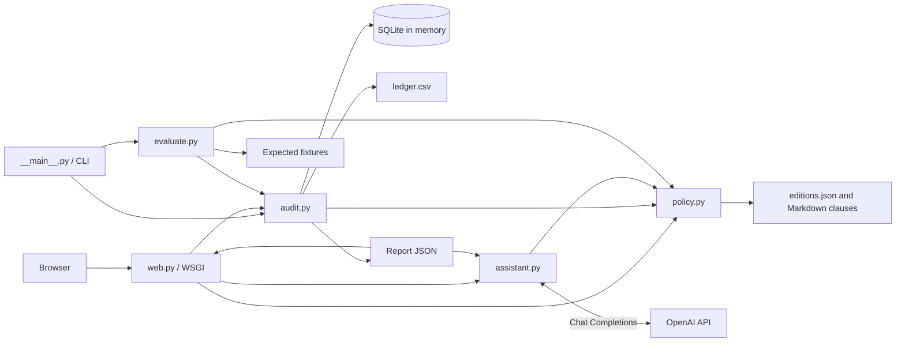
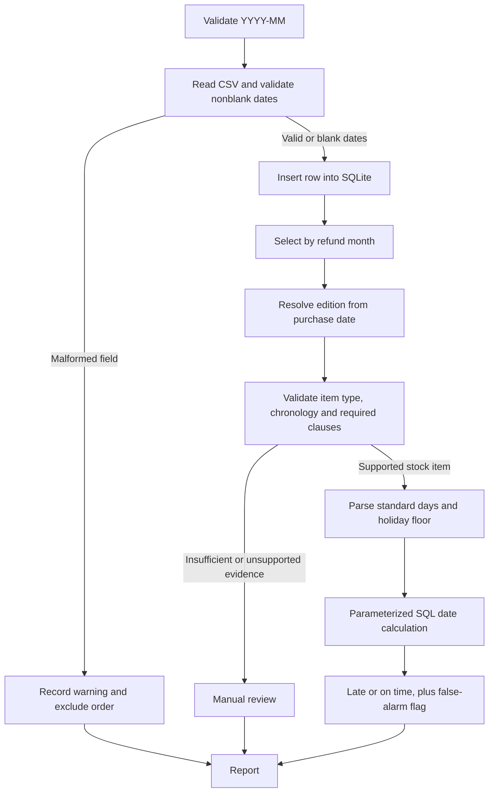
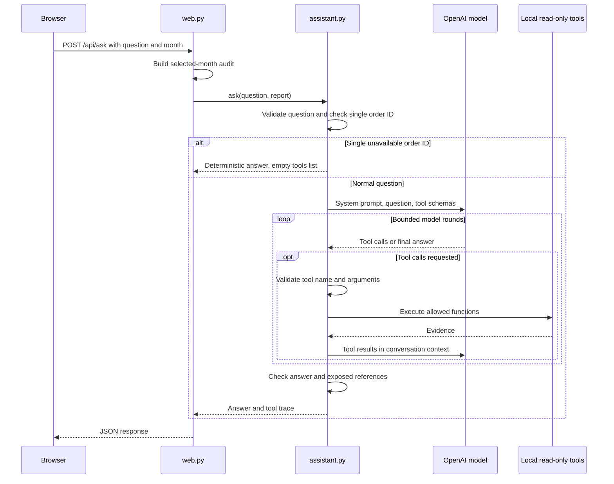

# ReturnLedger — Architecture

[Back to README](../README.md) · [Order walkthrough](WALKTHROUGH.md) · [Evaluation](EVALUATION.md)

## 1. Design goals

ReturnLedger separates a reproducible refund audit from an optional conversational layer. The audit owns deadlines, classifications and counts. The assistant reads those results and the policy documents to explain them. A model failure should not prevent a user from running the audit or inspecting its evidence.

The application is intentionally small: standard-library Python, in-memory SQLite, Markdown policies and a local WSGI server. The browser is implemented with HTML, CSS and JavaScript. There is no external database server, embedding model or agent framework.

## 2. Components



| Component | Responsibility |
| --- | --- |
| `__main__.py` | CLI dispatch for `serve`, `audit`, and `evaluate`. |
| `audit.py` | Validate input, load ledger, calculate dates, classify rows, aggregate evidence. |
| `policy.py` | Parse Markdown sections, choose policy edition, interpret supported rules, rank passages. |
| `assistant.py` | Validate questions, select and execute allowed tools, communicate with the model, check references. |
| `web.py` | Serve static assets and expose JSON endpoints. |
| `static/` | Render audit results, search results, warnings and assistant answers. |
| `evaluate.py` and `tests/` | Compare fixture outputs and exercise software behaviors. |

## 3. Inputs and evidence model

`data/ledger.csv` stores `order_id`, `purchased`, `delivered`, `item_type`, `requested` and `refunded`. The edition map in `data/editions.json` identifies effective purchase-date intervals and their Markdown files. The interval start is inclusive and the end exclusive.

Policy files contain named sections (`standard`, `holiday`, `exception`, `payment`). Each parsed clause has an edition, section name, text and source filename. The citation identifier combines edition and section, for example `2024-A#holiday`.

The report is a JSON object with `month`, `rows`, `import_warnings`, `counts`, `false_alarms` and `sources`. Rows include original order fields, status, deadline, days late, false-alarm flag, reason, evidence IDs and the policy edition when resolved. The sources map associates referenced IDs with their original file and text. Review rows can have null deadline and lateness values.

## 4. Deterministic audit pipeline



The database exists only for the duration of an audit. Valid records enter a table keyed by order ID. Parameterized SQL selects rows by the refund month and computes the date differences. The policy engine requires a unique edition and unique mandatory sections rather than relying on ranked retrieval.

The business rules are:

```text
standard_deadline = delivery_date + return_window_days
effective_deadline = max(standard_deadline, applicable_holiday_floor)
request_delta = request_date - effective_deadline
refund_delta = refund_date - effective_deadline
```

If no holiday floor applies, the effective deadline is the standard deadline. A positive request delta means `late`; a zero or negative delta means `on_time`. `days_late` is the nonnegative request delta. `false_alarm` is true when the request is on time but the refund is posted after the deadline. Custom products, unresolved editions, missing dates, inconsistent chronology and unsupported policy wording can require review.

Malformed nonblank dates are import errors, not ordinary review findings. Each invalid field is reported, and its order is excluded once. The warnings are not restricted to the selected month.

### Example: NQ-103

The order was purchased January 1, delivered January 10, requested January 31 and refunded February 7, 2025. The 2025 policy allows 21 days from delivery and has no holiday extension. SQL calculates January 31 as the deadline, a request delta of zero and a refund delta of seven. The result is `on_time`, `days_late=0`, `false_alarm=true`.

## 5. Three ways to retrieve policy information

The system deliberately distinguishes mandatory lookup from conversational retrieval.

| Path | Selection method | Used by |
| --- | --- | --- |
| Mandatory clause lookup | Exact edition and section; requires a unique match | Audit engine |
| Lexical search | Edition filter, token overlap and term-frequency / rarity weighting | Browser search and `search_policy` |
| Full-edition retrieval | All parsed clauses belonging to one edition | `read_policy` |

Lexical retrieval is easy to inspect for a tiny corpus, but a synonym-only query may return nothing. The assistant's focused search exposes at most three results. Full-edition retrieval avoids the top-k cutoff for comparisons; it would be less appropriate for very long documents without additional context limits.

## 6. Assistant tools

The optional assistant sends tool definitions and the question to OpenAI Chat Completions. The model proposes function calls; Python executes the functions and returns serialized results. Tools do not modify files, issue refunds or run arbitrary SQL.

| Tool | Arguments | Returned evidence |
| --- | --- | --- |
| `read_audit` | None (`{}`) | Current report, including rows, counts, sources and import warnings. |
| `search_policy` | `query`: string; `edition`: known ID | Up to three matching citation-to-text entries. |
| `read_policy` | `edition`: known ID | Citation-to-text entries for the selected edition. |

### Request flow



The system prompt routes audit questions to `read_audit`, targeted policy questions to `search_policy` and comprehensive comparisons to `read_policy`. It fixes the reporting month, requests citations, tells the model to respect review statuses and prefers plain text for the browser.

### Why the third tool was added

The original assistant had two tools and could miss one of the four policy sections when comparing two editions. A more explicit comparison question triggered the tool-batch limit. Rather than removing execution bounds, full-edition retrieval was added. A local comparison then returned all four categories with citations from both editions and a trace containing two `read_policy` calls.

This is a tool-granularity trade-off: focused search reduces irrelevant context; full retrieval reduces repeated calls and missing sections on broad questions.

## 7. Validation, reliability and limitations

- Questions must be nonempty strings within the accepted length limit (600 characters).
- The missing-order pre-check extracts NQ IDs and compares a single requested ID with the report's rows and import warnings. If unavailable, it returns a direct answer without sending a model request. This means unavailable **in the selected audit**, not necessarily absent from the entire ledger. The current shortcut is not a general mixed-order or intent-aware lookup.
- Tool names, argument shapes and known editions are checked in Python. The original execution design limits model requests to four rounds and each tool batch to four calls; the full-policy tool is designed to work within those bounds.
- Exposed order IDs and policy citations are tracked. The generated response is rejected when it is empty, lacks a tool trace or contains recognized references that were not exposed. Deterministic missing-order answers bypass this generated-response check.
- The local assistant changes extend the provider timeout from 35 to 90 seconds and add warning logs for HTTP failures and incomplete/unavailable responses. The UI keeps a concise error message; diagnostic logging should not contain secrets. A timeout change alone does not prove the original cause of an intermittent failure.
- Reference validation does not verify every claim, numeric value or natural-language interpretation. Prompt instructions are guidance, not a security boundary. Duplicate calls, malformed model messages, incomplete retrieval and provider failures remain possible.

## 8. HTTP interface and deployment

The WSGI server uses `wsgiref.simple_server`. The CLI binds to `127.0.0.1:8080` by default. Static assets and the API use the same local server.

| Method | Route | Inputs |
| --- | --- | --- |
| GET | `/api/audit` | `month` query parameter, default `2025-02` |
| GET | `/api/search` | `q`, `edition` (default `2025-A`) |
| POST | `/api/ask` | `month` query parameter and JSON `{"question":"..."}` |

The ask endpoint rebuilds the report for the requested month before calling the assistant. The original HTTP adapter enforces JSON content type and a request-body size limit of 4096 bytes, returns JSON errors for handled invalid requests, and disables caching. The browser receives answer text and tool names; there is no persistent chat history in this flow.

The server reads `OPENAI_API_KEY` and `OPENAI_MODEL` from its process environment. Local checks used GPT-6 Luna with `reasoning_effort` set to `none`. A `.env` file is not loaded automatically. Credentials stay on the server side; only the selected question and requested evidence are sent to the model. The Docker image uses Python 3.12, copies application and data directories, runs as a non-root user and exposes port 8080. The updated Docker execution remains to be checked.

## 9. Verification and next steps

| Verification | Recorded result |
| --- | --- |
| Existing automated tests | 26 passed before adding `read_policy` |
| Audit evaluation | 11/11 after local improvements |
| Focused retrieval evaluation | 8/8 Top-1 after local improvements |
| Manual integration scenarios | All five observed passing during iterative local checks |

The manual scenarios covered focused retrieval, full-edition comparison, combined audit/policy evidence, missing-order handling and refund-date false alarms. These results do not certify accuracy for unseen questions or prove the final state passed the automated suite. New tests should cover full-edition retrieval, unknown editions, missing-order bypass without a provider call and interactions with the existing reference checks.

Other useful extensions are persistent data storage, broader independent evaluation fixtures, paraphrase-aware retrieval, claim-level grounding checks, better request diagnostics and production-grade authentication and serving. They are future work, not current features.

The design is a single-user demonstration using synthetic records and policy text. The narrow rule grammar and small ledger are deliberate constraints; the model is never the source of audit decisions.
